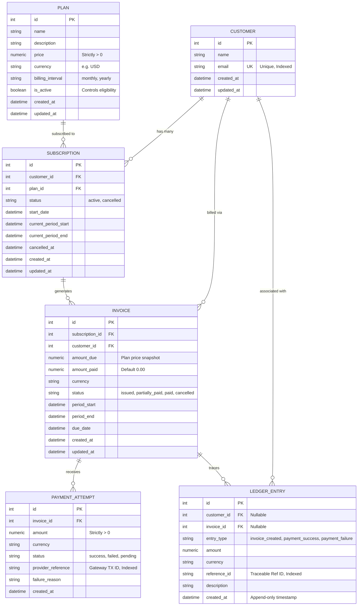
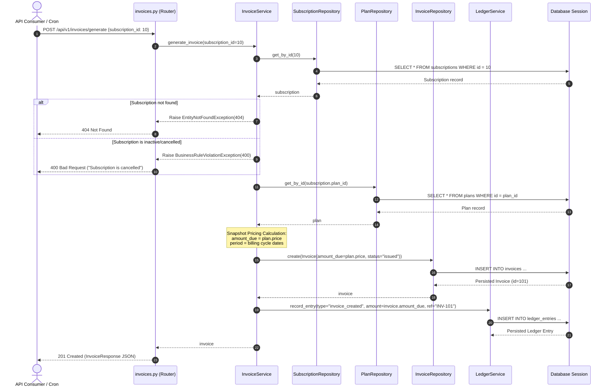
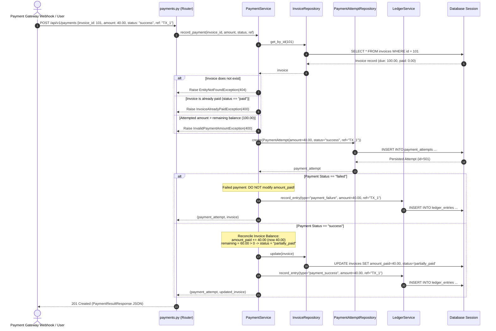
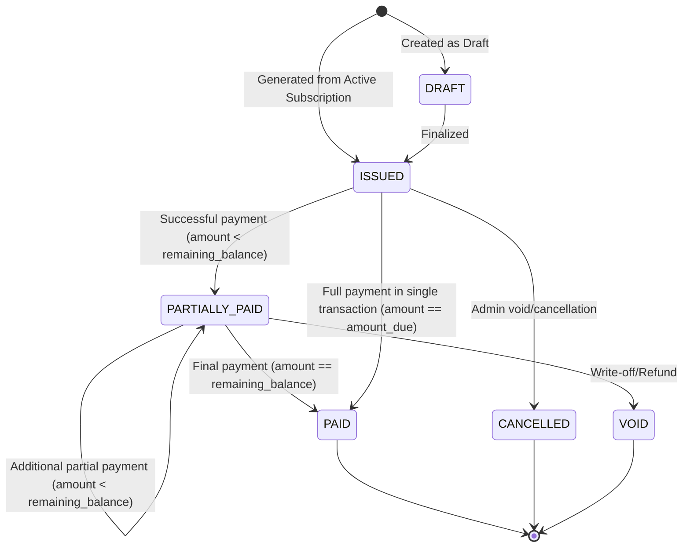
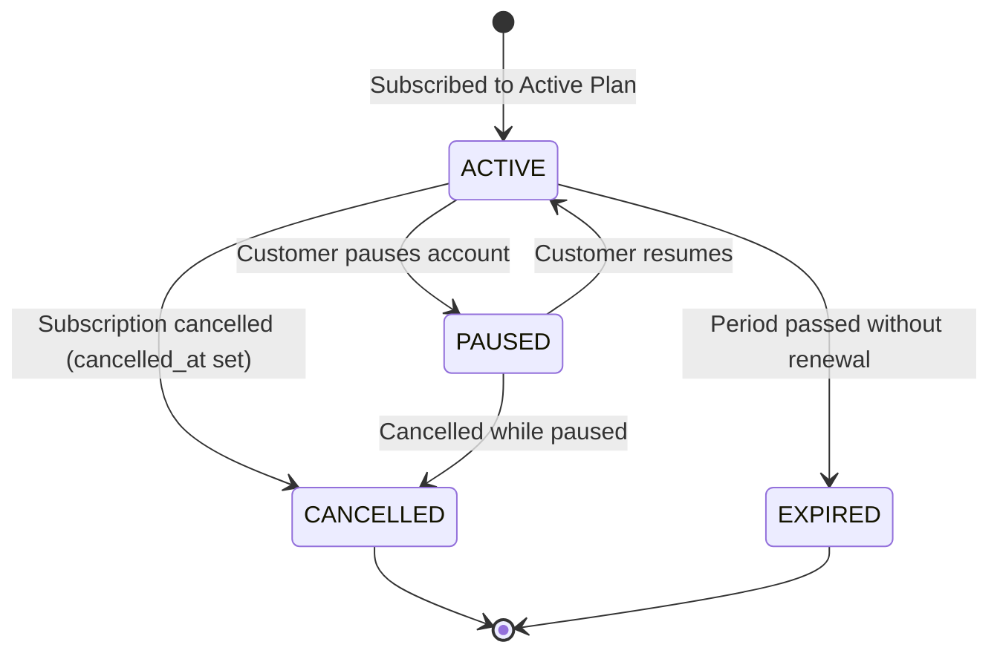

# SubLedger - Low-Level Design (LLD) Document
**System**: SaaS Subscription, Invoicing & Billing Engine  
**Standard**: SOLID Principles, Clean Layered Architecture, Repository Pattern, Append-Only Financial Ledger

---

## 1. System Overview & Objectives

**SubLedger** is a billing and ledger backend designed for SaaS applications. The system orchestrates customers, recurring plans, lifecycle subscriptions, deterministic invoice generation, payment attempt recording with partial payment reconciliation, and an immutable financial audit ledger.

### Key Architectural Objectives:
1. **Separation of Concerns**: Strict boundary separation across Presentation (Routes), Business Logic (Services), Data Persistence (Repositories), Relational Schemas (Models), and Data Transfer Objects (Pydantic Schemas).
2. **SOLID Compliance**: Systematic adherence to all five SOLID design principles across classes and interfaces.
3. **Data Integrity & Financial Precision**: Use of exact fixed-point decimals (`Numeric(12, 2)` / `decimal.Decimal`) to eliminate floating-point inaccuracies.
4. **Auditability**: An immutable, append-only ledger tracking all revenue and transaction events linked by persistent reference IDs.

---

## 2. Domain Model & Entity Relationships

The domain contains 6 core entities:
- **`Customer`**: Holds account identity and unique email.
- **`Plan`**: Represents a recurring pricing plan with `price > 0`, billing frequency, and active availability.
- **`Subscription`**: Couples a `Customer` to a `Plan` with lifecycle states (`active`, `cancelled`).
- **`Invoice`**: Point-in-time billing document capturing a snapshot of plan pricing (`amount_due`) and cumulative successful payments (`amount_paid`).
- **`PaymentAttempt`**: Records external payment transactions (gateway reference, status, failure reasons).
- **`LedgerEntry`**: Append-only chronological financial record.

### Entity-Relationship Diagram (Mermaid)



---

## 3. Layered Architecture

SubLedger employs a classic 4-Tier Clean Architecture:

```mermaid
flowchart TD
    Client(["HTTP Client / Frontend / Webhooks"]) -->|JSON Request| API["Presentation Layer (app/api/v1)"]
    
    subgraph Presentation ["Presentation Layer"]
        API --> Controllers["FastAPI APIRouters\n• customers.py\n• plans.py\n• subscriptions.py\n• invoices.py\n• payments.py\n• ledger.py"]
        Schemas["Pydantic DTOs (app/schemas)\n• Validation & Serialization\n• Positive price / amount checks"]
        Controllers -.-> Schemas
    end

    Controllers -->|Depends(get_service)| Services["Service Layer (app/services)"]
    
    subgraph BusinessLogic ["Business Logic Layer"]
        Services --> CustServ["CustomerService"]
        Services --> PlanServ["PlanService"]
        Services --> SubServ["SubscriptionService"]
        Services --> InvServ["InvoiceService"]
        Services --> PayServ["PaymentService"]
        Services --> LedgServ["LedgerService"]
    end

    BusinessLogic -->|Injected Repositories| Repositories["Data Access Layer (app/repositories)"]

    subgraph DataAccess ["Repository Layer"]
        Repositories --> BaseRepo["BaseRepository[T]"]
        Repositories --> CustRepo["CustomerRepository"]
        Repositories --> PlanRepo["PlanRepository"]
        Repositories --> SubRepo["SubscriptionRepository"]
        Repositories --> InvRepo["InvoiceRepository"]
        Repositories --> PayRepo["PaymentAttemptRepository"]
        Repositories --> LedgRepo["LedgerRepository (Append-Only)"]
    end

    DataAccess -->|SQLAlchemy Sessions| Database[("Database Engine\n• SQLite / PostgreSQL\n• ACID Transactions")]
```

---

## 4. Sequence Diagrams for Core Flows

### 4.1. Flow 1: Invoice Generation Flow



---

### 4.2. Flow 2: Payment Recording Flow



---

## 5. State Machine Diagrams

### 5.1. Invoice Lifecycle State Machine



### 5.2. Subscription Lifecycle State Machine



---

## 6. SOLID Principles Mapping & Implementation Proof

| Principle | Name | Where & How Applied in SubLedger |
|---|---|---|
| **S** | **Single Responsibility Principle (SRP)** | • **Routes** (`app/api/v1/*`): Responsible *only* for HTTP status codes, request parsing, and delegating to services.<br>• **Services** (`app/services/*`): Responsible *only* for business logic rules and orchestrating repositories.<br>• **Repositories** (`app/repositories/*`): Responsible *only* for database queries and ORM persistence.<br>• **Models** (`app/models/*`): Responsible *only* for database table schema and column mapping.<br>• **Schemas** (`app/schemas/*`): Responsible *only* for input validation and output serialization. |
| **O** | **Open/Closed Principle (OCP)** | • Repositories inherit from generic `BaseRepository[T]`. Concrete repositories extend functionality without modifying the base class.<br>• Custom exception hierarchy (`SubLedgerException`) permits adding new domain errors without modifying API handlers.<br>• Payment gateways can be extended via strategy patterns without altering `PaymentService`. |
| **L** | **Liskov Substitution Principle (LSP)** | • Concrete repositories (`CustomerRepository`, `PlanRepository`, etc.) can be substituted wherever `BaseRepository` is expected.<br>• In `LedgerRepository`, mutation methods (`update`, `delete`) explicitly reject modification to protect the immutable domain invariant while maintaining full interface compatibility. |
| **I** | **Interface Segregation Principle (ISP)** | • Services only declare and inject the exact repositories they need (e.g. `InvoiceService` takes `subscription_repo`, `plan_repo`, `invoice_repo`, `ledger_service`; it does not receive unrelated customer or payment repositories).<br>• Pydantic schemas segregate Create, Update, and Response views. |
| **D** | **Dependency Inversion Principle (DIP)** | • High-level modules (Services) do not create low-level dependencies (`Session`, raw SQL). Instead, dependencies are injected into constructors (`__init__`).<br>• FastAPI's `Depends()` provider layer (`app/api/deps.py`) manages dependency resolution and enables effortless mocking in test suites (`conftest.py`). |

---

## 7. Business Rule Ownership Matrix

| Business Rule | Owner (Entity / Service / Schema) | Enforcement Mechanism |
|---|---|---|
| **Plan price must be > 0** | `PlanCreate` Schema & `PlanService` | Pydantic `@field_validator("price")` + `PlanService.create_plan` condition check |
| **Customer email must be unique** | `Customer` Model & `CustomerService` | Database unique constraint + `CustomerRepository.get_by_email()` check raising `DuplicateResourceException` |
| **Cannot subscribe to inactive plan** | `SubscriptionService` | `Plan.is_active` check raising `InactivePlanException` |
| **No duplicate active subscription to same plan** | `SubscriptionService` | `SubscriptionRepository.get_active_by_customer_and_plan()` raising `DuplicateActiveSubscriptionException` |
| **Invoice amount_due from plan price at creation** | `InvoiceService` | Point-in-time snapshot of `plan.price` copied to `invoice.amount_due` |
| **Payment cannot exceed unpaid balance** | `PaymentService` | `amount <= invoice.remaining_balance` validation raising `InvalidPaymentAmountException` |
| **Invoice status moves to paid / partially_paid** | `PaymentService` | State transition logic comparing updated `amount_paid` to `amount_due` |
| **Failed payment does not increase amount_paid** | `PaymentService` | Explicit branch: only persist `PaymentAttempt` and emit `payment_failure` ledger event |
| **Append-only traceable ledger** | `LedgerRepository` & `LedgerService` | Explicit disallowing of `update` and `delete` in repository; `reference_id` indexing on each event |

